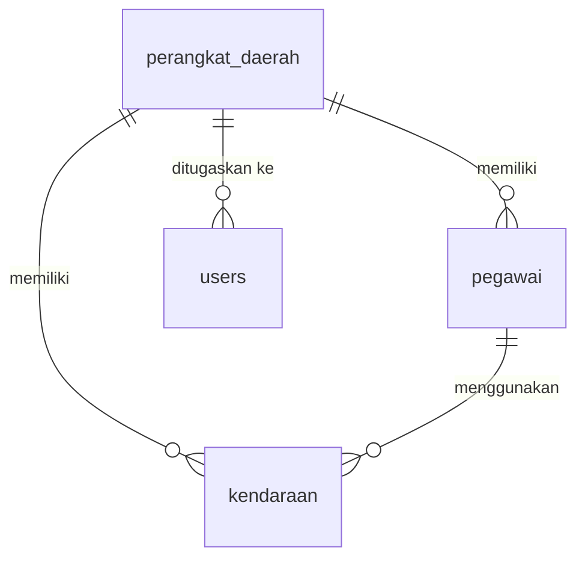
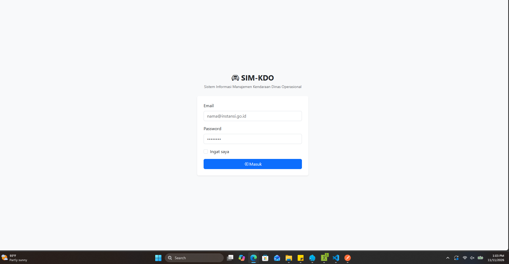
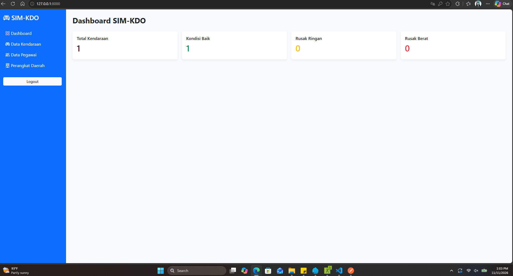

# SIM-KDO

**Sistem Informasi Manajemen Kendaraan Dinas Operasional** — aplikasi Laravel untuk mendata kendaraan dinas, pegawai pengguna, dan perangkat daerah (OPD), lengkap dengan REST API ber-token.

---

## Teknologi

| Komponen | Versi / Keterangan |
| --- | --- |
| PHP | 8.3 |
| Laravel | 13 |
| Database | MySQL (database `sim_kdo`) |
| Autentikasi Web | Session guard (login/logout) |
| Autentikasi API | Laravel Sanctum v4.4 (Bearer token) |
| Tampilan | Blade + Bootstrap 5.3 CDN (server-side, tanpa SPA) |
| Aset | Vite 8 + Tailwind CSS 4 |
| Testing | PHPUnit 12 (class-based, bukan Pest) |
| Kode Style | Laravel Pint |

Paket tambahan yang sudah terpasang: `barryvdh/laravel-dompdf` (PDF) dan `maatwebsite/excel` (Excel) — siap dipakai, belum digunakan oleh fitur mana pun.

---

## Fitur

**Web (Blade)**
- Login / logout dengan session
- Dashboard ringkasan: total kendaraan, kondisi Baik / Rusak Ringan / Rusak Berat
- CRUD Kendaraan, Pegawai, dan Perangkat Daerah (soft delete)
- Pencarian & filter (kata kunci, kondisi, status)
- Menu **Perangkat Daerah** hanya tampil untuk role admin

**REST API (`/api`)**
- Login token, profil (`/me`), logout
- CRUD Kendaraan, Pegawai, Perangkat Daerah
- Paginasi, filter, dan validasi berbahasa Indonesia

---

## Peran & Hak Akses

| Role | Kendaraan & Pegawai | Perangkat Daerah |
| --- | --- | --- |
| **admin** | Semua data | Penuh (CRUD) |
| **operator** | Hanya data `perangkat_daerah_id` miliknya | `403` |

Untuk operator, `perangkat_daerah_id` yang dikirim akan dipaksa memakai milik user sendiri; mengakses data perangkat daerah lain menghasilkan `403`.

---

## Struktur Proyek

```
app/
  Http/
    Controllers/
      Controller.php                 # base + helper currentUser()
      AuthController.php             # login/logout web (session)
      DashboardController.php        # ringkasan kendaraan
      KendaraanController.php        # CRUD web kendaraan
      PegawaiController.php          # CRUD web pegawai
      PerangkatDaerahController.php  # CRUD web perangkat daerah (admin)
      Api/
        ApiController.php            # base API: scope kepemilikan + paginasi
        AuthController.php           # login/me/logout API (token)
        KendaraanController.php
        PegawaiController.php
        PerangkatDaerahController.php
    Requests/Api/                    # validasi API (Store*/Update*, LoginRequest)
    Resources/                       # bentuk JSON (Kendaraan/Pegawai/PerangkatDaerah)
  Models/
    User.php                         # role, perangkat_daerah_id, isAdmin()
    PerangkatDaerah.php              # tabel: perangkat_daerah
    Pegawai.php                      # tabel: pegawai
    Kendaraan.php                    # tabel: kendaraan

database/
  migrations/                        # skema tabel (lihat bagian Database)
  seeders/DatabaseSeeder.php         # 1 perangkat daerah + 2 akun demo

resources/views/
  layouts/app.blade.php              # layout sidebar
  auth/login.blade.php
  dashboard/index.blade.php
  kendaraan/  pegawai/  perangkat-daerah/   # index, create, edit, show, _form

routes/
  web.php                            # route halaman web
  api.php                            # route REST API (prefix nama "api.")
  console.php

tests/
  Feature/AuthSmokeTest.php          # login & hak akses halaman web
  Feature/KendaraanCrudTest.php      # CRUD via web
  Feature/Api/                       # ApiAuthTest, ApiKendaraanTest,
                                     # ApiPegawaiTest, ApiPerangkatDaerahTest

docs/
  API.md                             # dokumentasi REST API lengkap
  postman/SIM-KDO.postman_collection.json
```

---

## Database

Database MySQL bernama `sim_kdo` (12 tabel). Yang menjadi inti aplikasi:

| Tabel | Isi |
| --- | --- |
| `users` | Akun login: `name`, `email`, `password`, `role` (`admin`/`operator`), `perangkat_daerah_id` |
| `perangkat_daerah` | OPD: `kode_pd` (unik), `nama_pd`, `alamat`, `nama_kepala_pd`, `no_telepon`, `status` |
| `pegawai` | `perangkat_daerah_id`, `nama`, `nip` (unik), `jabatan`, `golongan`, `pangkat`, `no_telepon`, `status` |
| `kendaraan` | `perangkat_daerah_id`, `pegawai_id` (opsional), `nomor_polisi` (unik), `merk`, `tipe_model`, `tahun_produksi`, `warna`, `nomor_rangka`, `nomor_mesin`, `jenis_kendaraan`, `bahan_bakar`, `kondisi`, `status_penggunaan`, `nomor_register`, `kode_barang`, `tanggal_perolehan`, `nilai_perolehan` |
| `personal_access_tokens` | Token API Sanctum |

Sisanya tabel bawaan Laravel: `password_reset_tokens`, `sessions`, `cache`, `cache_locks`, `jobs`, `job_batches`, `failed_jobs`.

### Relasi



# 🖼 Preview

## 📊Login

<p align="center">
  
</p>


<p align="center">
  
</p>


<p align="center">
  
</p>


<p align="center">
  
</p>


### Aturan penting

- `perangkat_daerah` dan `pegawai` memakai **soft delete** (`deleted_at`).
- Menghapus perangkat daerah **ditolak** jika masih punya pegawai atau kendaraan (guard di controller, `restrictOnDelete` di DB).
- Hapus pegawai → `kendaraan.pegawai_id` menjadi `NULL` (`nullOnDelete`).
- `kondisi`: `Baik` | `Rusak Ringan` | `Rusak Berat`.
- `status_penggunaan`: `Digunakan` | `Tidak Digunakan` | `Dalam Perawatan` | `Dihapuskan`.

---

## Menjalankan

Prasyarat: PHP 8.3, Composer, MySQL (Laragon / XAMPP), Node.js.

```sh
composer install
npm install

cp .env.example .env        # Windows: copy .env.example .env
php artisan key:generate

# Buat database `sim_kdo` di MySQL, lalu sesuaikan .env:
# DB_DATABASE=sim_kdo  DB_USERNAME=root  DB_PASSWORD=

php artisan migrate --seed
php artisan serve            # http://127.0.0.1:8000
```

Opsional untuk mengembangkan aset:

```sh
npm run dev                  # atau: npm run build
```

### Akun demo (hasil seeder)

| Email | Password | Role |
| --- | --- | --- |
| `admin@sim-kdo.test` | `password` | admin |
| `operator@sim-kdo.test` | `password` | operator (Dinas Pendidikan) |

---

## REST API

Base URL `http://127.0.0.1:8000/api`. Autentikasi memakai header `Authorization: Bearer {token}`.

| Method | Endpoint | Keterangan |
| --- | --- | --- |
| `POST` | `/api/login` | Login, dapat token |
| `GET` | `/api/me` | Profil user login |
| `POST` | `/api/logout` | Hapus token |
| `GET/POST` | `/api/kendaraan` | Daftar / tambah kendaraan |
| `GET/PUT/DELETE` | `/api/kendaraan/{id}` | Detail / ubah / hapus |
| `GET/POST` | `/api/pegawai` | Daftar / tambah pegawai |
| `GET/PUT/DELETE` | `/api/pegawai/{id}` | Detail / ubah / hapus |
| `GET/POST` | `/api/perangkat-daerah` | Daftar / tambah (admin) |
| `GET/PUT/DELETE` | `/api/perangkat-daerah/{id}` | Detail / ubah / hapus (admin) |

Contoh:

```sh
curl -s -X POST http://127.0.0.1:8000/api/login \
  -H "Content-Type: application/json" -H "Accept: application/json" \
  -d '{"email":"admin@sim-kdo.test","password":"password","device_name":"postman"}'
```

Dokumentasi lengkap (field, aturan validasi, contoh respons): **[`docs/API.md`](docs/API.md)**.

### Postman

Import `docs/postman/SIM-KDO.postman_collection.json`, lalu jalankan request **Auth > Login** — token tersimpan otomatis ke variabel `{{token}}` dan dipakai semua request lain.

---

## Testing

```sh
php artisan test                 # seluruh test
php artisan test --filter=Api    # hanya test API
```

Test memakai SQLite in-memory (lihat `phpunit.xml`), jadi tidak mengganggu database MySQL.

> Catatan: semua nama route API diberi prefix `api.` (mis. `api.kendaraan.index`) agar tidak bertabrakan dengan nama route web `kendaraan.index` yang dipakai `redirect()->route(...)` di halaman Blade.

---

## Konvensi Kode

- Indentasi controller & test: **2 spasi**; view Blade: **5 spasi**.
- Pesan validasi dan flash message memakai **Bahasa Indonesia**.
- Akses user login selalu lewat `$this->currentUser()` (helper di `Controller.php`) agar tipe `App\Models\User` jelas bagi analisis statis.
- API memisahkan validasi (`Requests/Api`) dan bentuk respons (`Resources`).
